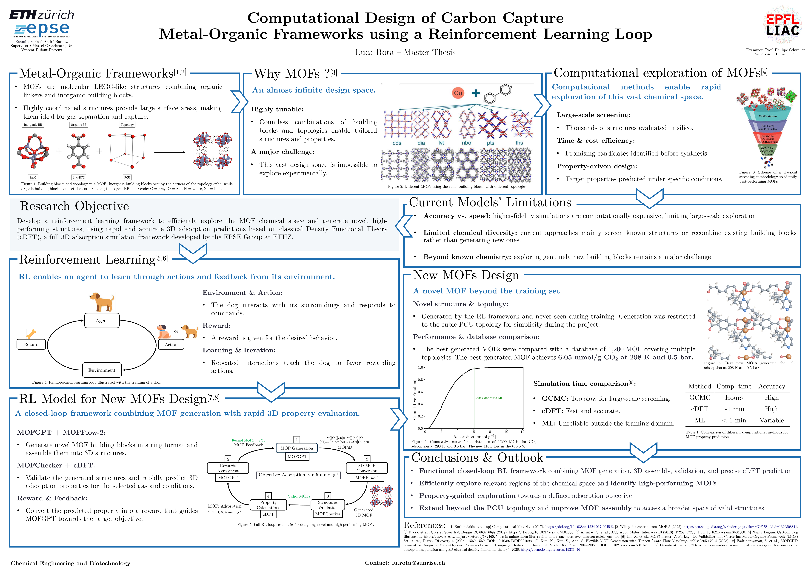

# Computational Design of Carbon Capture Metal-Organic Frameworks using a Reinforcement Learning Loop

**Master Thesis** · Luca Rota

| | |
|---|---|
| **Degree** | M.Sc. in Chemical Engineering and Biotechnology (EPFL & ETH Zürich) |
| **Period** | October 2025 – May 2026 |
| **Host group** | [EPSE](https://epse.ethz.ch) – Energy and Process Systems Engineering, **ETH Zürich** (Prof. André Bardow) |
| **Collaboration** | [LIAC](https://www.epfl.ch/labs/liac) – Laboratory of Artificial Chemical Intelligence, **EPFL** (Prof. Philippe Schwaller) |
| **Contact** | lu.rota@sunrise.ch |

> This repository is a showcase. The full thesis, the code and the data are not public. Only this description and the poster are published.

## Poster

*Click the poster to open the PDF.*

## What is it about?

Metal-Organic Frameworks (MOFs) are porous materials that can be seen as molecular LEGO structures: organic linkers and inorganic building blocks are connected into a network with a very large surface area. This makes them attractive for gas separation and capture, for example of CO₂.

Because building blocks and topologies can be combined almost freely, the design space is practically infinite and impossible to explore experimentally. Classical screening approaches also have limits: accurate simulations are computationally expensive, and they mostly evaluate known structures or recombine existing building blocks.

## Goal

To develop a reinforcement learning (RL) framework that efficiently explores the chemical space of MOFs and **generates new** MOFs with high CO₂ uptake, instead of only evaluating known structures. Each generated structure is evaluated quickly and accurately with a 3D adsorption simulation.

## Principle

The framework is a closed loop of five steps:

1. **Generation:** a generative language model proposes new MOFs as a text (string) representation of their building blocks.
2. **3D assembly:** a full 3D structure is built from this representation.
3. **Validation:** invalid structures are filtered out.
4. **Simulation:** the CO₂ adsorption of the valid structures is computed.
5. **Reward:** the computed adsorption is converted into a reward that updates the generative model, so that it proposes structures closer to the target in the next round.

By repeating this loop, the model learns to focus on promising regions of the chemical space. For simplicity, generation was restricted to the cubic PCU topology in this project.

## Models and tools

| Step | Model / tool | Reference |
|---|---|---|
| Generation | **MOFGPT**, generative language model for MOFs, trained with RL | [Badrinarayanan et al., J. Chem. Inf. Model. 65 (2025)](https://doi.org/10.1021/acs.jcim.5c01625) |
| 3D assembly | **MOFFlow-2**, flow-matching model that builds 3D structures from the string representation | [Kim et al., arXiv:2505.17914 (2025)](https://arxiv.org/abs/2505.17914) |
| Validation | **MOFChecker**, validation and correction of MOF structures | [Jin et al., Digital Discovery 4 (2025)](https://doi.org/10.1039/D5DD00109A) |
| Simulation | **cDFT** (classical Density Functional Theory), 3D adsorption simulation developed by the EPSE group at ETH Zürich | [Granderath et al., data on Zenodo (2026)](https://zenodo.org/records/19331046) |

The cDFT simulation is the key component of the loop: it is much faster than GCMC simulations (about one minute per structure instead of hours) and accurate enough to serve as feedback for learning.

## My work

I built and ran the whole pipeline, from reproducing the original models to the final closed loop:

- Reproduced MOFGPT, evaluated its fine-tuning and RL training routes, and modified the RL training and the reward function to get a more stable learning signal and avoid the model generating the same structure repeatedly.
- Compared MOFFlow and MOFFlow-2 for the 3D assembly and wrote the adaptation layer between MOFGPT and MOFFlow-2.
- Integrated MOFChecker to filter invalid structures and replaced the machine-learning property predictor of the original pipeline with the 3D cDFT simulation as the source of the reward.
- Ran the experiments for CO₂ adsorption on remote GPU servers and compared the best generated MOFs with a reference database of 1,200 MOFs.
- Presented the progress weekly to my supervisors.

The pipeline is mostly written in Python (PyTorch, Hugging Face, RDKit, Open Babel, MOFChecker).
